# 📋 Sistema de Gestão de Tarefas (ToDo)

API RESTful para gerenciamento de tarefas (.NET 8), com Docker MySQL, execução com F5 no Visual Studio e Swagger na raiz (login e **Authorize**).

[](https://dotnet.microsoft.com/)
[](https://www.mysql.com/)
[](https://www.docker.com/)
[](https://github.com/eutiagoportela/SistemaTarefas/actions/workflows/ci.yml)

---

## 🚀 Teste rápido: API hospedada (Swagger)

| Item | Valor |
|------|--------|
| **Repositório** | https://github.com/eutiagoportela/SistemaTarefas |
| **Swagger (demo)** | https://sistema-tarefas-api-1rdd.onrender.com |
| **OpenAPI JSON** | https://sistema-tarefas-api-1rdd.onrender.com/swagger/v1/swagger.json |
| **Health** | https://sistema-tarefas-api-1rdd.onrender.com/health |

**Passos no Swagger online:**

1. **GET /health** → `Healthy` (plano free do Render pode demorar ~1 min após idle).
2. **POST /api/v1/auth/login** com o JSON:

```json
{
  "nomeUsuario": "demo",
  "senha": "DemoSegura2026!"
}
```

3. Copie `dados.token` → **Authorize** → `Bearer {token}`.
4. **POST /api/v1/tarefas** ou **GET /api/v1/tarefas** → anote **`id`** e **`versao`** (tarefa nova: `versao` = `1`).
5. **PUT** (ou DELETE / iniciar / concluir / reabrir) → header **`If-Match`** = número **`versao`** (não use `traceId` da resposta).

CRUD, filtros, autenticação JWT e demais capacidades: [Funcionalidades](#-funcionalidades) e [Endpoints da API](#-endpoints-da-api). Arquitetura, testes e instalação local: índice abaixo.

**Rodar local (F5):** [Instalação e Configuração](#-instalação-e-configuração) com login `admin` / `Admin123`.

---

## 📋 Índice

- [Teste rápido: API hospedada](#-teste-rápido-api-hospedada-swagger)
- [Sobre o Projeto](#-sobre-o-projeto)
  - [Destaques](#-destaques)
- [Funcionalidades](#-funcionalidades)
- [Tecnologias Utilizadas](#-tecnologias-utilizadas)
  - [Backend](#backend)
  - [Segurança](#segurança)
  - [Qualidade e testes](#qualidade-e-testes)
  - [Ferramentas](#ferramentas)
- [Arquitetura](#️-arquitetura)
  - [Princípios e padrões](#princípios-e-padrões-aplicados)
- [Fluxos do Projeto](#-fluxos-do-projeto)
  - [1. Docker (API e banco)](#1-fluxo-docker-api--banco)
  - [2. TDD do domínio](#2-fluxo-tdd-do-domínio-fase-1)
  - [3. Polly (resiliência)](#3-fluxo-de-resiliência-polly)
  - [4. HTTP (Swagger)](#4-fluxo-http-swagger--banco--resposta)
  - [5. DDD (camadas e comandos)](#5-fluxo-ddd-dependências-entre-camadas)
  - [Observabilidade nos fluxos](#observabilidade-cliente--servidor)
- [Pré-requisitos](#-pré-requisitos)
- [Instalação e Configuração](#-instalação-e-configuração)
  - [Passo 1: Clonar](#-passo-1-clonar-o-repositório)
  - [Passo 2: MySQL (Docker)](#-passo-2-iniciar-o-mysql-com-docker)
  - [Passo 3: Restaurar pacotes](#-passo-3-restaurar-pacotes)
  - [Passo 4: Migrations / seed](#-passo-4-banco-de-dados-migrations)
  - [Passo 5: Executar a API](#-passo-5-executar-a-api)
  - [Passo 6: Testes automatizados](#-passo-6-executar-os-testes-automatizados)
- [Testes Automatizados](#-testes-automatizados)
  - [Visão geral (4 projetos)](#visão-geral)
  - [Exemplos (Domain)](#exemplos-de-testes-domain)
  - [Exemplos (Application e Architecture)](#exemplos-application-e-architecture)
  - [Exemplos (Integração)](#exemplos-integração)
  - [Comandos dotnet test](#quando-usar-cada-comando)
- [Endpoints da API](#-endpoints-da-api)
- [Testes Manuais (Swagger)](#-testes-manuais-via-swagger-ou-postman)
  - [Autenticação e registro](#autenticação-e-registro)
  - [Tarefas (CRUD e consultas)](#tarefas-crud-e-consultas)
  - [Status da tarefa](#status-da-tarefa)
  - [Segurança HTTP](#segurança-http)
- [Estrutura do Projeto](#-estrutura-do-projeto)
  - [Arquivos na raiz (CPM, props)](#arquivos-na-raiz-gestão-centralizada-da-solution)
- [Solução de Problemas](#-solução-de-problemas)
- [Demo hospedada](#-demo-hospedada)

---

## 📖 Sobre o Projeto

Sistema para **criar, listar, atualizar e concluir tarefas** (ToDo), com status (Pendente, Em andamento, Concluído), filtros por vencimento e status, autenticação JWT e respostas padronizadas (`RespostaPadrao`).

### 🎯 Destaques

✨ **Domínio rico (DDD)**: agregado `Tarefa`, value objects, eventos de domínio e auditoria

🏗️ **Clean Architecture**: Api, Application, Domain, Infrastructure e Communication, com Domain sem dependências externas

🔒 **Segurança**: JWT + BCrypt + refresh token rotacionado

⚡ **Concorrência otimista**: `ETag` no GET + header `If-Match` em PUT e comandos de status

✅ **TDD no Domain**: regras nascem dos testes em `SistemaTarefas.Domain.Tests`

🔄 **Polly**: retry e circuit breaker apenas no `UnitOfWork.CommitAsync`

📚 **Swagger na raiz**: login → copiar token → **Authorize** → testar rotas protegidas

---

## 🚀 Funcionalidades

- ✅ **CRUD de Tarefas**: criar, listar (filtros + paginação), obter por ID, atualizar e excluir (soft delete)
- ✅ **Autenticação JWT**: registrar, login, refresh e logout
- ✅ **Fluxo de status**: iniciar, concluir e reabrir tarefa
- ✅ **Filtros**: status, vencimento, atrasadas, busca textual
- ✅ **Validações**: FluentValidation na Application + regras no Domain
- ✅ **Respostas padronizadas**: envelope `RespostaPadrao` em todos os endpoints
- ✅ **Documentação interativa**: Swagger/OpenAPI com descrições por endpoint, códigos HTTP e JWT (**Authorize**)
- ✅ **Histórico**: trilha em `AuditoriaRegistros` a partir de eventos de domínio
- ✅ **Observabilidade**: Serilog por requisição; `ILogger` nos use cases (auth e tarefas) para falhas de negócio; middleware para exceções. Resposta JSON com `traceId`; detalhe operacional nos logs do servidor (sem senha)
- ✅ **Seed**: usuário admin criado no primeiro startup (Development)
- ✅ **Docker Compose**: MySQL com healthcheck; API opcional em container

---

## 🛠️ Tecnologias Utilizadas

### Backend
- **.NET 8**: ASP.NET Core Web API
- **Entity Framework Core 8**: ORM
- **MySQL 8.0**: banco relacional
- **Pomelo.EntityFrameworkCore.MySql 8**: provider MySQL

### Segurança
- **JWT Bearer**: access token
- **BCrypt.Net-Next**: hash de senhas

### Qualidade e testes
- **xUnit**, **Moq**, **FluentAssertions**
- **NetArchTest**: regras de dependência entre camadas
- **Testcontainers**: testes de integração com MySQL

### Ferramentas
- **FluentValidation**: validação de requests
- **Polly**: resiliência no commit
- **Serilog**, **OpenTelemetry** (console)
- **Swashbuckle**: Swagger/OpenAPI
- **Docker Compose**: MySQL e stack completa

---

## 🏗️ Arquitetura

O projeto segue **Clean Architecture** com **DDD** na camada de domínio:

```
┌─────────────────────────────────────────┐
│           API (Apresentação)            │  ← Controllers, Middlewares, JWT
├─────────────────────────────────────────┤
│         Application (Casos de Uso)      │  ← Use Cases, Validators, Resultado
├─────────────────────────────────────────┤
│       Domain (Entidades e Contratos)    │  ← Tarefa, VO, Eventos, IRepository
├─────────────────────────────────────────┤
│   Infrastructure (Implementações)       │  ← EF Core, Repositories, Polly, JWT
├─────────────────────────────────────────┤
│    Communication (Contratos de API)     │  ← Requests, Responses, RespostaPadrao
└─────────────────────────────────────────┘
```

### Princípios e Padrões Aplicados

- ✅ **SOLID**: responsabilidades separadas por camada
- ✅ **DRY**: mapeamentos e validadores reutilizáveis
- ✅ **Dependency Injection**: `AddJwtAuthentication`, `AddMySqlConfiguration`, `AddApplication`
- ✅ **Repository Pattern**: abstração de persistência
- ✅ **Unit of Work**: commit único; repositórios não chamam `SaveChanges`
- ✅ **Use Case Pattern**: uma operação por interface/classe
- ✅ **Result Pattern**: `Resultado<T>` na Application; HTTP via `ResultadoHttp`
- ✅ **Domain Events**: auditoria derivada no commit
- ✅ **Logging na Application**: controllers só chamam `ParaHttp`; validação, auth, 404/409 e regras de domínio registradas com `ILogger<T>` nos use cases

---

## 🔀 Fluxos do Projeto

Visão de como o sistema **sobe**, como o **domínio foi construído**, como o **banco se protege** e como uma **requisição HTTP** percorre as camadas.

### 1. Fluxo Docker (API ↔ banco)

**Stack completa** (`docker compose up --build`): a API só inicia depois do MySQL **healthy**; connection string por variável de ambiente; migrations no startup.

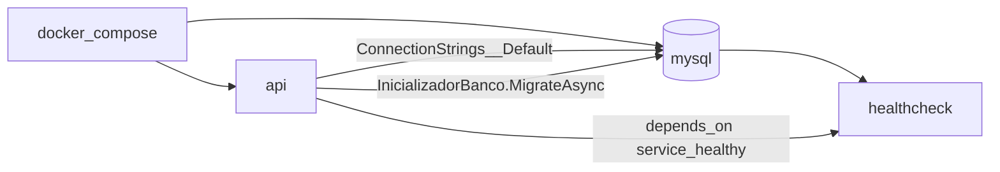

| Modo | Comando | API | Banco |
|------|---------|-----|-------|
| **Desenvolvimento local (F5)** | `docker compose up -d mysql` + **F5** | `localhost:5000` | `localhost:3307` |
| **Tudo em container** | `docker compose up --build` | `:5000` | serviço `mysql` na rede Docker |

No **F5**, o `InicializadorBanco` (`Program.cs`) executa `MigrateAsync` e cria o usuário **admin** (até 10 tentativas se o MySQL ainda estiver subindo).

```text
[F5]  Visual Studio → SistemaTarefas.Api → http://localhost:5000
      Docker         → tarefas-mysql:3307
      Startup        → migrations + seed
```

---

### 2. Fluxo TDD do domínio (Fase 1)

Ordem de construção: **teste falha → agregado / VO / eventos → teste passa**. Application, Infrastructure e HTTP **não entram** neste ciclo.

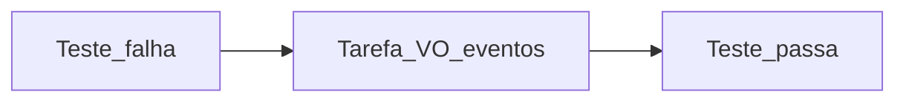

| Ordem | Exemplo de teste (`SistemaTarefas.Domain.Tests`) |
|-------|--------------------------------------------------|
| 1 | Título curto / vazio |
| 2 | Vencimento no passado |
| 3 | Transição ilegal (iniciar duas vezes, concluir sem iniciar) |
| 4 | Reabrir após concluir |
| 5 | Fluxo feliz pendente → em andamento → concluído |

---

### 3. Fluxo de resiliência (Polly)

Polly fica **somente** em `UnitOfWork.CommitAsync`, envolvendo `SaveChangesAsync`. Domain e use cases **não** conhecem Polly.

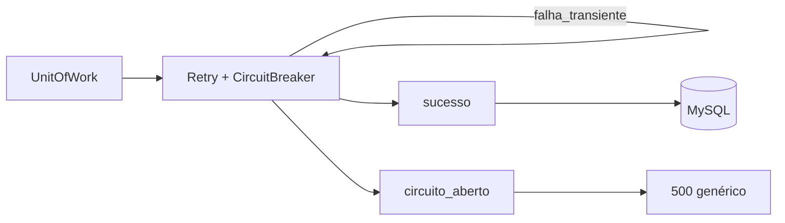

| Peça | Comportamento |
|------|----------------|
| **Retry** | Até 3 tentativas em falhas transientes de EF (não inclui concorrência) |
| **Circuit breaker** | Após muitas falhas, commit falha rápido |
| **Concorrência** | `DbUpdateConcurrencyException` → middleware **412** (If-Match / versão) |

O Pomelo também tem retry na **conexão** (`MySqlConfig`): isso é separado do Polly do commit.

---

### 4. Fluxo HTTP (Swagger → banco → resposta)

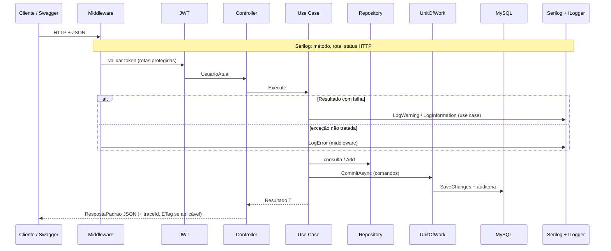

Falhas de negócio vão no **envelope** (`mensagem`, `erros`, **`traceId`**) e, em paralelo, no **log do servidor** (validação, auth, 404/409, domínio). Ver [Observabilidade nos fluxos](#observabilidade-cliente--servidor).

**Login e Authorize:**

1. `POST /api/v1/auth/login` → copiar `dados.token`
2. Swagger **Authorize** → `Bearer {token}`
3. Chamar rotas de tarefas com cadeado fechado

**Comandos com versão:** `GET /api/v1/tarefas/{id}` devolve header **ETag**; `PUT`, `DELETE` e `POST .../iniciar|concluir|reabrir` exigem **If-Match** com essa versão.

---

### 5. Fluxo DDD (dependências entre camadas)

**DDD tático** aqui significa: regras de negócio **dentro** do Domain (agregado + value objects); Application **coordena** sem substituir o domínio; Infrastructure **implementa** persistência e JWT. A API só traduz HTTP ↔ use cases.

#### Linguagem ubíqua (termos do código)

| Termo | Significado no sistema |
|-------|-------------------------|
| **Tarefa** | Agregado raiz do ToDo; dono = `UsuarioId` |
| **Status** | `Pendente` → `EmAndamento` → `Concluido` (reabrir volta a `Pendente`) |
| **Versão** | Controle de concorrência otimista (`Versao` + ETag / If-Match) |
| **Usuário** | Agregado de identidade; login emite JWT (fora do agregado Tarefa) |
| **Auditoria** | Registro derivado de **eventos de domínio**, não é agregado exposto na API |

#### Agregados e limites

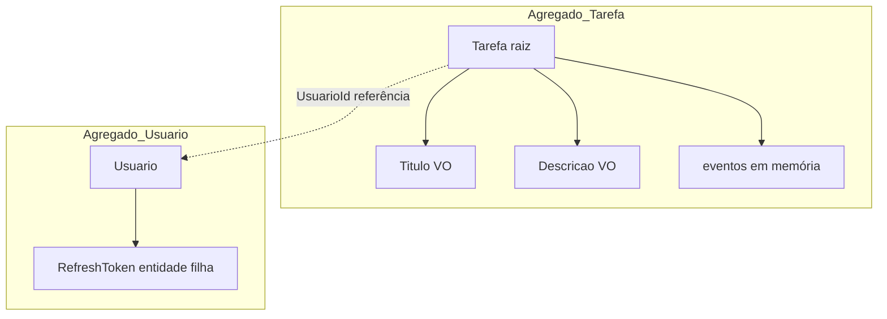

| Agregado | Raiz | O que **não** fazer |
|----------|------|---------------------|
| **Tarefa** | `Tarefa` | Alterar título/status por setter público; sempre via `Criar`, `Iniciar`, `Concluir`, etc. |
| **Usuario** | `Usuario` | Criar usuário no controller; use `RegistrarUsuarioUseCase` + `Usuario.Criar` |

`RefreshToken` pertence ao contexto de **auth**, não à Tarefa. Repositórios expõem **portas** no Domain (`ITarefaRepository`), implementação na Infrastructure.

#### Máquina de estados da Tarefa (regras no Domain)

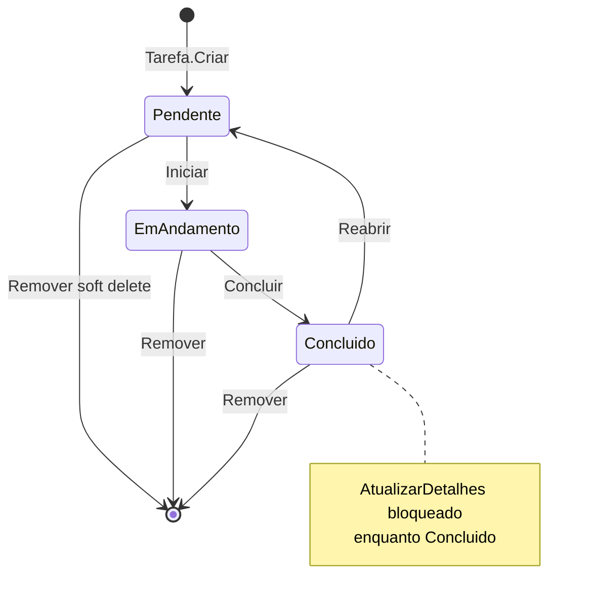

Cada transição válida pode **incrementar `Versao`** e, em alguns casos, **registrar evento** (`TarefaConcluida`, `TarefaReaberta`, `TarefaCriada`).

#### Mapa de referências (dependências entre camadas)

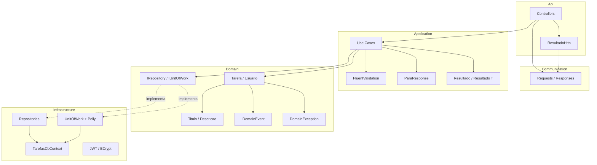

| Camada | Pode | Não pode |
|--------|------|----------|
| **Domain** | Regras, VO, eventos, interfaces de repositório | Referenciar EF, HTTP, JWT, DTOs |
| **Application** | Orquestrar, validar entrada, `Resultado<T>`, logs de falha (`ILogger`) | `SaveChanges`, DbContext, detalhes SQL |
| **Infrastructure** | EF, repositórios, UoW, Polly, token | Regra de negócio de tarefa |
| **Api** | Auth HTTP, headers ETag/If-Match, status code | `if (status == Concluido)` de negócio |

Testes **`DependenciasTests`** (Architecture) garantem que essas fronteiras não sejam quebradas no código.

#### Comando × consulta (CQRS leve)

| Tipo | Exemplos | Domínio | Commit |
|------|----------|---------|--------|
| **Comando** | Criar, PUT, iniciar/concluir/reabrir, excluir | Métodos no agregado | `IUnitOfWork.CommitAsync` |
| **Consulta** | Listar, obter por id, histórico | Só leitura; `ParaResponse` | Geralmente **sem** UoW (histórico usa `IAuditoriaConsulta`) |

Listar aplica filtros no **repositório** (Infrastructure), mas **não muda** o agregado: é projeção para `TarefaResponse`.

---

#### Fluxo DDD detalhado: **criar tarefa** (`POST /api/v1/tarefas`)

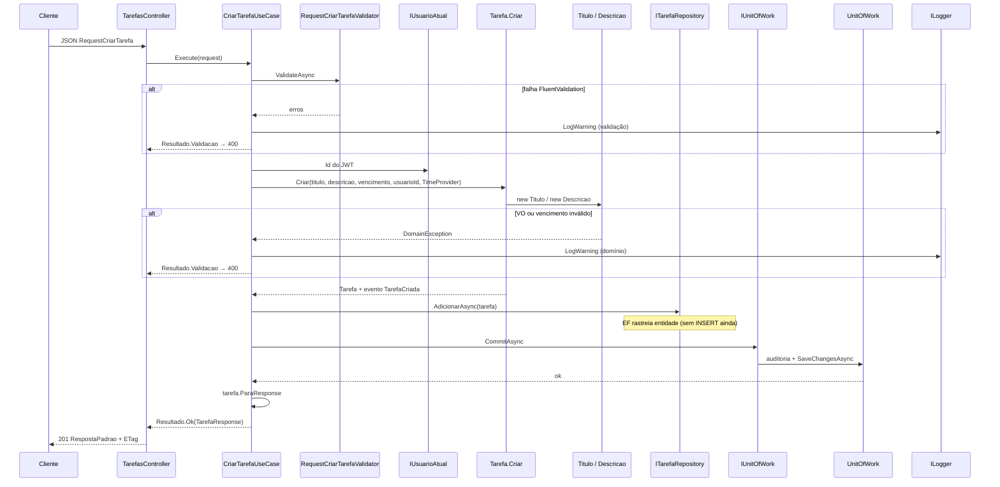

**Passo a passo (arquivos):**

1. `TarefasController.Criar`: recebe `RequestCriarTarefa` (Communication).
2. `CriarTarefaUseCase`: validação **de entrada** (FluentValidation).
3. `Tarefa.Criar`: validação **de negócio** (vencimento futuro, VO de título).
4. `TarefaRepository.AdicionarAsync`: adiciona ao `DbContext` (memória).
5. `UnitOfWork.CommitAsync`: lê eventos do agregado → `AuditoriaRegistros` → `SaveChanges` (Polly).
6. `TarefaMappings.ParaResponse`: monta DTO **sem** expor entidade EF na API.
7. `ResultadoHttp.ParaHttp`: envelope `RespostaPadrao` (+ `traceId`).
8. Em falha (passos 2–3): `CriarTarefaUseCase` → `LogWarning` (servidor); cliente recebe 400 no JSON.

---

#### Fluxo DDD detalhado: **concluir tarefa** (comando + versão)

1. **Api:** `If-Match` lido no controller → `uint versao` (If-Match inválido → 400 no controller, só Serilog).
2. **Application:** `ComandosTarefaUseCase.Concluir` → carrega tarefa → **autorização** (dono ou admin) → `LogWarning` se não encontrada ou acesso negado.
3. **Application:** se `versao != tarefa.Versao` → `LogWarning` (versões) → `Resultado.Conflito` (409) **antes** de chamar o domínio.
4. **Domain:** `tarefa.Concluir(relogio)`: se não estiver `EmAndamento`, `DomainException` → `LogWarning` → `Resultado.Validacao`.
5. **Domain:** adiciona `TarefaConcluida` à lista interna de eventos.
6. **Infrastructure:** `CommitAsync` persiste mudanças + linhas de auditoria; `Versao` sobe (token de concorrência EF).
7. **Api:** `ParaHttp`: 200 + ETag; mesmo padrão vale para iniciar, reabrir, PUT e DELETE.

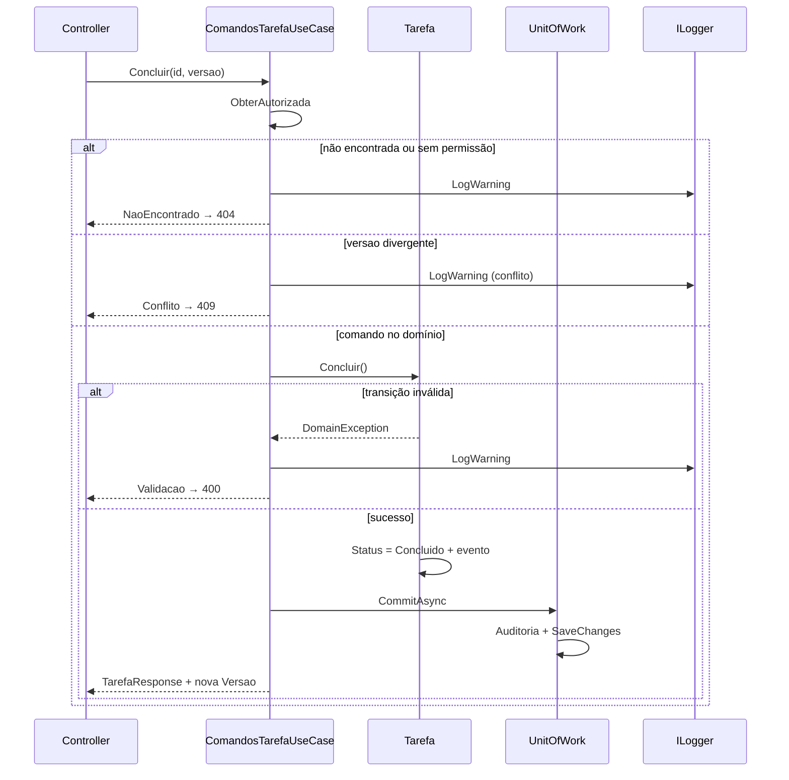

---

#### Fluxo DDD detalhado: **listar tarefas** (consulta)

1. `ListarTarefasUseCase`: normaliza paginação (Application).
2. `IUsuarioAtual`: restringe query ao `UsuarioId` (ou admin vê todas).
3. `TarefaRepository.ListarAsync`: IQueryable + filtros (status, vencimento, atrasadas, busca).
4. **Sem** `CommitAsync`: nenhum evento de domínio disparado.
5. Projeção: `Select` implícito via `ParaResponse` em memória após materializar página.
6. **Log:** use case não emite log de negócio no caminho feliz; **Serilog** registra o `GET` e o status.

---

#### Value Objects e persistência (anti-corruption na Infrastructure)

- `Titulo` e `Descricao` validam no **construtor** (Domain).
- `TarefasDbContext` converte VO ↔ coluna string (`HasConversion`): EF é detalhe de Infrastructure; Domain não sabe que existe MySQL.

---

#### Três caminhos de “erro” (onde cada um nasce)

| Origem | Mecanismo | HTTP típico |
|--------|-----------|-------------|
| JSON inválido / campo vazio | FluentValidation → `Resultado.Validacao` | 400 |
| Regra de negócio (VO, transição) | `DomainException` capturada no use case **ou** middleware | 400 / 422 |
| Recurso / versão / auth | `Resultado` (`NaoEncontrado`, `Conflito`, `NaoAutorizado`) | 404 / 409 / 401 |
| Concorrência EF | `DbUpdateConcurrencyException` | 412 |
| Falha infra (Polly circuito) | Exception não tratada | 500 |

Os use cases devolvem **`Resultado<T>`**; o controller só traduz para HTTP. Regra de negócio não fica na Api.

#### Observabilidade: cliente × servidor

| Canal | O que aparece |
|-------|----------------------|
| **Resposta HTTP** | `RespostaPadrao` com `traceId` (correlacionar com log da requisição Serilog) |
| **Use cases (auth)** | Tentativa/sucesso de login, credenciais inválidas, registro duplicado, refresh inválido |
| **Use cases (tarefas)** | Validação, tarefa inexistente, acesso negado (404 genérico ao cliente), conflito de `versao` (409), regra de domínio |
| **Api** | `ExceptionHandlingMiddleware` → `LogError` em exceção não tratada |
| **Infrastructure** | Seed/retry MySQL no startup (`InicializadorBanco`) |

Senhas e tokens completos **não** entram em log.

**Por quê separar JSON e log?** Em ambiente **hospedado** (Render, container, etc.) não há depurador attach: o **`traceId`** na resposta permite ao usuário ou suporte apontar uma falha; nos **Logs** do serviço, o Serilog mostra a requisição (método, rota, status) e o use case registra o **motivo de negócio** (401, 409, acesso negado) sem expor isso no corpo HTTP nem gravar senha. Controllers continuam finos (`Resultado` → `ParaHttp`); a decisão e o diagnóstico ficam na Application.

---

#### Eventos de domínio → auditoria (mesma transação)

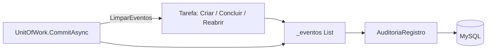

| Evento | Quando | Uso |
|--------|--------|-----|
| `TarefaCriada` | `Tarefa.Criar` | Histórico + rastreio |
| `TarefaConcluida` | `Concluir` | Histórico |
| `TarefaReaberta` | `Reabrir` | Histórico |

`GET .../historico` lê **AuditoriaRegistros** via `IAuditoriaConsulta`: não reexecuta regras do agregado.

---

#### Auth no DDD (login: fluxo resumido)

Auth é **caso de uso de aplicação** + **infra de token**, não passa pelo agregado `Tarefa`:

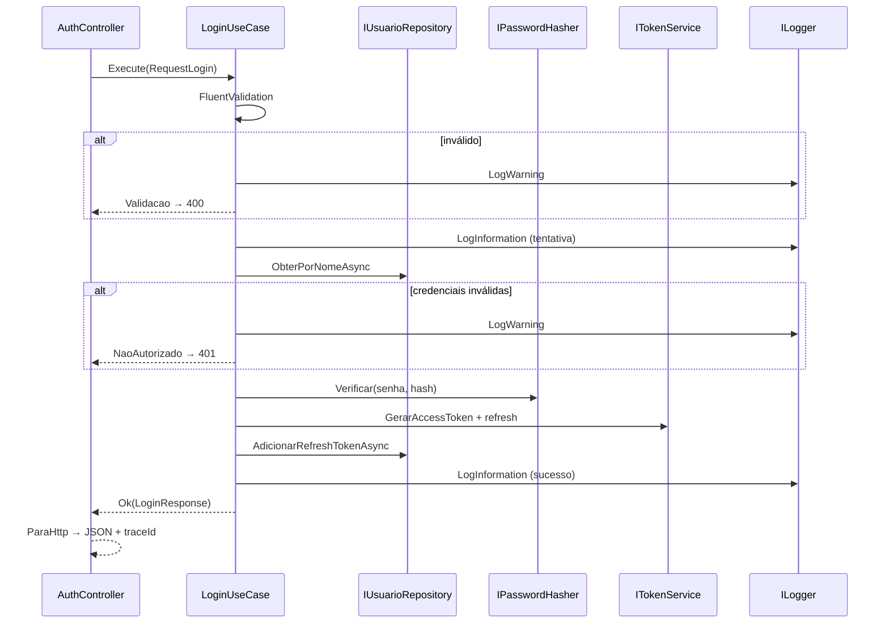

**Passos (arquivos):**

1. `LoginUseCase` → `IUsuarioRepository.ObterPorNomeAsync`
2. `IPasswordHasher.Verificar` (Infrastructure / BCrypt)
3. `ITokenService.GerarAccessToken` (Infrastructure / JWT)
4. `AdicionarRefreshTokenAsync` + `CommitAsync`: persiste refresh **sem** alterar campos desnecessários do usuário
5. `RegistrarUsuarioUseCase` / `RefreshTokenUseCase`: mesmo padrão: `Resultado` para o cliente, `ILogger` para falhas (senha **nunca** logada)

---

## 📦 Pré-requisitos

| Software | Versão mínima |
|----------|----------------|
| **.NET SDK** | 8.0 |
| **Docker Desktop** | recente |
| **Git** | recente (opcional) |

**Opcional:** Visual Studio 2022, Postman, MySQL Workbench.

---

## 💻 Instalação e Configuração

### 📥 Passo 1: Clonar o repositório

```bash
git clone https://github.com/eutiagoportela/SistemaTarefas.git
cd SistemaTarefas
```

### 🐳 Passo 2: Iniciar o MySQL com Docker

Na pasta raiz (onde está o `docker-compose.yml`):

```bash
docker compose up -d mysql
```

**Verificar:**

```bash
docker ps
```

Container esperado: **`tarefas-mysql`**, porta **3307 → 3306**.

⏳ Aguarde o healthcheck ficar **healthy** (cerca de 20–40 s).

### 📦 Passo 3: Restaurar pacotes

```bash
dotnet restore
```

### 🗄️ Passo 4: Banco de dados (migrations)

**Não é obrigatório rodar CLI manualmente**: na subida da API, o `InicializadorBanco` executa `MigrateAsync` e cria o usuário admin.

Opcional (CLI):

```bash
dotnet ef database update --project src/SistemaTarefas.Infrastructure --startup-project src/SistemaTarefas.Api
```

**Seed (Development):**

| Usuário | Senha |
|---------|--------|
| `admin` | `Admin123` |

### ▶️ Passo 5: Executar a API

**Opção A: Visual Studio (recomendado)**

1. Abrir `SistemaTarefas.sln`
2. Startup project: **SistemaTarefas.Api**
3. **F5**

**Opção B: CLI**

```bash
dotnet run --project src/SistemaTarefas.Api
```

**Opção C: Docker (API + MySQL)**

```bash
docker compose up --build
```

**URLs:**

```
🌐 Swagger UI:     http://localhost:5000
🏥 Health Check:   http://localhost:5000/health
📡 API Base:       http://localhost:5000/api/v1
```

**Console esperado (Development):**

```
API SistemaTarefas em http://localhost:5000
Swagger na raiz. Login: POST /api/v1/auth/login
```

### 🧪 Passo 6: Executar os testes automatizados

**Via .NET CLI (rápido: sem integração):**

```bash
dotnet test --filter "Category!=Integration"
```

**Suite completa (inclui integração: Docker Desktop ligado):**

```bash
dotnet test
```

**Via Visual Studio:**

1. Menu **Teste** → **Gerenciador de Testes** (ou `Ctrl+E, T`)
2. **Executar** todos (`Ctrl+R, A`)

**Resultado esperado:** 15 testes aprovados, 0 falhas (12 unitários/arquitetura + 3 integração).

---

## 🧪 Testes Automatizados

A solution possui **4 projetos de teste** (visíveis no **Gerenciador de Testes** do Visual Studio). Eles validam camadas diferentes: complementam o [roteiro manual resumido](#-testes-manuais-via-swagger-ou-postman) no Swagger, provando regras de negócio, arquitetura e fluxo HTTP ponta a ponta.

### Visão geral

| Projeto | Qtd. | O que garante |
|---------|------|----------------|
| `SistemaTarefas.Domain.Tests` | 8 | **TDD do domínio**: agregado `Tarefa`, título/descrição, vencimento futuro, transições (iniciar, concluir, reabrir). Sem HTTP e sem banco. |
| `SistemaTarefas.Application.Tests` | 2 | **Use case** `CriarTarefaUseCase`: validação de entrada e chamada ao `CommitAsync` (Moq). |
| `SistemaTarefas.Architecture.Tests` | 2 | **NetArchTest**: Domain não referencia Application/Infrastructure/Api; Application não referencia Infrastructure/Api. |
| `SistemaTarefas.Api.IntegrationTests` | 3 | **Integração**: Testcontainers (MySQL) + `WebApplicationFactory`: login/criar tarefa, PUT com **If-Match**, OpenAPI expõe header **If-Match** no Swagger. |

### Exemplos de testes (Domain)

- `Criar_DeveFalhar_QuandoTituloForCurto`
- `Criar_DeveFalhar_QuandoVencimentoNaoForFuturo`
- `FluxoFeliz_IniciarConcluirReabrir`
- `Iniciar_DeveFalhar_QuandoNaoEstiverPendente`

### Exemplos (Application e Architecture)

- `Execute_DevePersistir_QuandoDadosValidos` / `Execute_DeveRetornarValidacao_QuandoTituloVazio`
- `Domain_NaoDeveDependerDeOutrasCamadas`
- `Application_NaoDeveDependerDeInfrastructureNemApi`

### Exemplos (Integração)

- `Login_E_CriarTarefa_DeveFuncionar`: auth + POST tarefa (HTTP real).
- `AtualizarTarefa_ComIfMatch_DeveRetornarOk`: PUT com header de versão.
- `OpenApi_PutTarefas_DeveIncluirHeaderIfMatch`: contrato Swagger/OpenAPI.

Todos os testes de integração usam `[Trait("Category", "Integration")]` e exigem **Docker** em execução.

### Quando usar cada comando

| Comando | Quando |
|---------|--------|
| `dotnet test --filter "Category!=Integration"` | CI rápido, desenvolvimento do dia a dia (~100 ms) |
| `dotnet test` | Antes de entregar; valida também API + banco |
| Gerenciador de Testes (VS) | Mesmo que CLI; útil para debugar um teste isolado |

Ferramentas: **xUnit**, **Moq**, **FluentAssertions**, **NetArchTest.Rules**, **Testcontainers.MySql**.

---

## 📡 Endpoints da API

| Método | Rota | Auth |
|--------|------|------|
| POST | `/api/v1/auth/registrar` | Não |
| POST | `/api/v1/auth/login` | Não |
| POST | `/api/v1/auth/refresh` | Não |
| POST | `/api/v1/auth/logout` | Sim |
| GET / POST | `/api/v1/tarefas` | Sim |
| GET / PUT / DELETE | `/api/v1/tarefas/{id}` | Sim |
| POST | `/api/v1/tarefas/{id}/iniciar`, `/concluir`, `/reabrir` | Sim + **If-Match** |
| GET | `/api/v1/tarefas/{id}/historico` | Sim |
| GET | `/health`, `/health/ready` | Não |

---

## 🧪 Testes Manuais via Swagger ou Postman

Use o **Swagger na raiz** (local `http://localhost:5000` ou [demo hospedada](#-teste-rápido-api-hospedada-swagger)): login → **Authorize** (`Bearer {token}`) → exercitar rotas da tabela [Endpoints da API](#-endpoints-da-api).

**Corpos mínimos (local: admin / Admin123):**

```json
// POST /api/v1/auth/login
{ "nomeUsuario": "admin", "senha": "Admin123" }

// POST /api/v1/tarefas (autenticado)
{ "titulo": "Minha tarefa", "descricao": "Opcional", "dataVencimento": "2026-12-15T18:00:00Z" }
```

Em **PUT**, **DELETE** e **POST** `.../iniciar|concluir|reabrir`, informe **`If-Match`** = campo **`versao`** (ou ETag do GET). Ver [Teste rápido](#-teste-rápido-api-hospedada-swagger).

Respostas de erro vêm em `RespostaPadrao` (`sucesso: false`, `mensagem`, `erros`, `traceId`). Use `traceId` para achar a linha nos logs (Serilog + use case).

### Autenticação e registro

| Cenário | O que fazer no Swagger | Sucesso | Erros comuns |
|---------|------------------------|---------|--------------|
| Login | `POST /api/v1/auth/login` com JSON acima | **200** + `dados.token` | **401** usuário/senha errados; **400** campos vazios |
| Registrar | `POST /api/v1/auth/registrar` (usuário novo) | **200** | **409** nome já existe; **400** senha fraca ou inválida |
| Refresh | `POST /api/v1/auth/refresh` com `refreshToken` do login | **200** novo par de tokens | **401** token ausente, expirado ou revogado |

### Tarefas (CRUD e consultas)

| Cenário | O que fazer | Sucesso | Erros comuns |
|---------|-------------|---------|--------------|
| Criar | `POST /api/v1/tarefas` (Authorize ativo) | **201** + `versao` (geralmente `1`) | **401** sem token; **400** título curto ou data inválida |
| Listar / obter | `GET /api/v1/tarefas`, `GET /api/v1/tarefas/{id}` | **200** | **401** sem token; **404** id inexistente ou de outro usuário |
| Atualizar | `PUT /api/v1/tarefas/{id}` + header **If-Match** | **200** + `versao` incrementada | **428** sem If-Match; **400** If-Match não numérico; **409** versão desatualizada; **400** validação/domínio |
| Excluir | `DELETE /api/v1/tarefas/{id}` + **If-Match** | **200** (soft delete) | Mesmos **428** / **409** do PUT |
| Histórico | `GET /api/v1/tarefas/{id}/historico` | **200** lista de auditoria | **404** mesma regra do GET por id |

### Status da tarefa

| Cenário | O que fazer | Sucesso | Erros comuns |
|---------|-------------|---------|--------------|
| Fluxo feliz | `POST .../iniciar` → `.../concluir` → `.../reabrir` (If-Match atualizado a cada passo) | **200** em cada etapa | **400** transição inválida (ex.: concluir sem iniciar); **409** versão errada |
| Concluir direto | `POST .../concluir` com tarefa ainda **Pendente** | N/A | **400** (só conclui em **EmAndamento**) |

### Segurança HTTP

| Cenário | O que fazer | Sucesso | Erros comuns |
|---------|-------------|---------|--------------|
| Rota protegida | `GET /api/v1/tarefas` sem **Authorize** | N/A | **401** |
| Token inválido | Authorize com texto aleatório | N/A | **401** |

Mais combinações de **400**/**401** podem ser exploradas no Swagger. A suíte **`dotnet test`** cobre domínio, arquitetura, PUT com If-Match e contrato OpenAPI do header.

---

## 📁 Estrutura do Projeto

```plaintext
📦 Solution 'SistemaTarefas'
├── 📁 src/
│   ├── 📁 SistemaTarefas.Api/                         # 🎯 Apresentação
│   │   ├── 📁 Controllers/
│   │   │   ├── 📄 AuthController.cs                 # /api/v1/auth/*
│   │   │   └── 📄 TarefasController.cs                # CRUD + status + histórico
│   │   ├── 📁 Middlewares/
│   │   │   └── 📄 ExceptionHandlingMiddleware.cs
│   │   ├── 📁 Extensoes/
│   │   │   └── 📄 ResultadoHttp.cs
│   │   ├── 📄 Program.cs
│   │   └── 📄 appsettings.Development.json
│   │
│   ├── 📁 SistemaTarefas.Application/               # ⚙️ Casos de uso
│   │   ├── 📁 UseCases/
│   │   │   ├── 📁 Auth/
│   │   │   │   ├── 📄 LoginUseCase.cs
│   │   │   │   ├── 📄 RegistrarUsuarioUseCase.cs
│   │   │   │   └── 📄 RefreshTokenUseCase.cs
│   │   │   └── 📁 Tarefas/
│   │   │       ├── 📄 CriarTarefaUseCase.cs
│   │   │       ├── 📄 ListarTarefasUseCase.cs
│   │   │       ├── 📄 ObterTarefaUseCase.cs
│   │   │       └── 📄 ComandosTarefaUseCase.cs        # PUT, status, delete, histórico
│   │   ├── 📁 Validadores/
│   │   ├── 📁 Extensions/
│   │   │   └── 📄 DependencyInjectionExtension.cs
│   │   └── 📁 Abstracoes/                             # IUnitOfWork, IUsuarioAtual, ...
│   │
│   ├── 📁 SistemaTarefas.Communication/               # 📨 Contratos HTTP
│   │   ├── 📁 Requests/
│   │   └── 📁 Responses/
│   │       └── 📄 RespostaPadrao.cs
│   │
│   ├── 📁 SistemaTarefas.Domain/                      # 🧠 Domínio
│   │   ├── 📁 Entidades/
│   │   │   ├── 📄 Tarefa.cs                           # Agregado
│   │   │   └── 📄 Usuario.cs
│   │   ├── 📁 ValueObjects/
│   │   ├── 📁 Eventos/
│   │   ├── 📁 Repositorios/                           # Interfaces
│   │   └── 📁 Resultados/                             # Resultado<T>
│   │
│   └── 📁 SistemaTarefas.Infrastructure/              # 🔧 Infra
│       ├── 📁 Persistencia/
│       │   ├── 📄 TarefasDbContext.cs
│       │   ├── 📄 MySqlConfig.cs
│       │   └── 📄 InicializadorBanco.cs                 # MigrateAsync + seed
│       ├── 📁 Repositories/
│       │   ├── 📄 TarefaRepository.cs
│       │   ├── 📄 UsuarioRepository.cs
│       │   └── 📄 UnitOfWork.cs                         # Polly + auditoria
│       ├── 📁 Seguranca/
│       │   ├── 📄 Authentication.cs                     # JWT Bearer + DI
│       │   ├── 📄 TokenService.cs
│       │   └── 📄 PasswordHasher.cs
│       └── 📁 Migrations/
│
├── 📁 tests/
│   ├── 📁 SistemaTarefas.Domain.Tests/                # TDD
│   ├── 📁 SistemaTarefas.Application.Tests/
│   ├── 📁 SistemaTarefas.Architecture.Tests/
│   └── 📁 SistemaTarefas.Api.IntegrationTests/
│
├── 📄 Directory.Build.props                             # Propriedades comuns de todos os .csproj
├── 📄 Directory.Packages.props                        # Versões centralizadas de NuGet
├── 📄 global.json                                     # SDK .NET 8 fixo na solution
├── 📄 docker-compose.yml
├── 📄 Dockerfile
├── 📄 SistemaTarefas.sln
└── 📄 README.md
```

### Arquivos na raiz (gestão centralizada da solution)

| Arquivo | Função |
|---------|--------|
| **Directory.Build.props** | Aplica a **mesma configuração** em todos os projetos da pasta (`net8.0`, nullable, implicit usings, lang version). Evita repetir `<PropertyGroup>` em cada `.csproj`. |
| **Directory.Packages.props** | **Central Package Management (CPM)**: versões dos pacotes NuGet ficam **só aqui**; nos `.csproj` entra `<PackageReference Include="..." />` **sem** `Version=`. Facilita atualizar EF, Pomelo, xUnit etc. em um lugar. |
| **global.json** | Fixa qual SDK .NET a solution usa (8.0.426), para build reproduzível localmente e no CI. |

---

## 🔧 Solução de Problemas

| Problema | Solução |
|----------|---------|
| Swagger não abre (JSON 401 na raiz) | Stop + F5; Swagger configurado **antes** de auth; acesse `http://localhost:5000` |
| MySQL connection refused | `docker compose up -d mysql` e aguarde healthy |
| Login 412 / concorrência | Rebuild com API parada (versão antiga em memória) |
| Authorize não funciona | Use `Bearer {token}` no Swagger |
| PUT/iniciar retorna 428 | Envie header `If-Match` com o número **`versao`** (ex.: `1`) ou ETag do GET |
| **400** If-Match inválido | Não use **`traceId`**. Use só o campo **`versao`** do JSON ou ETag (ex.: `1`) |
| Entender falha além do JSON | Console local ou **Logs** no Render: Serilog (HTTP) + linhas `LogWarning` dos use cases; use `traceId` da resposta na mesma janela de tempo |
| Build falha (DLL locked) | Pare o debug no Visual Studio antes de compilar |

---

## 🌐 Demo hospedada

API no **Render** (Docker) com MySQL na nuvem. Links e roteiro: [Teste rápido: API hospedada](#-teste-rápido-api-hospedada-swagger).
