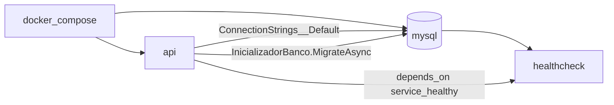
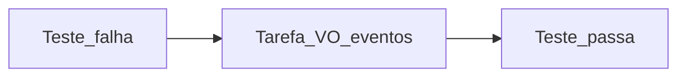
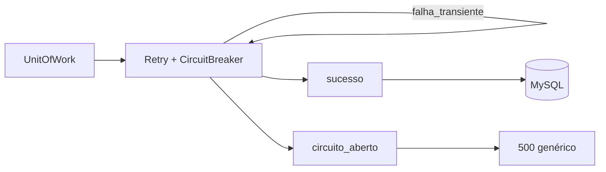
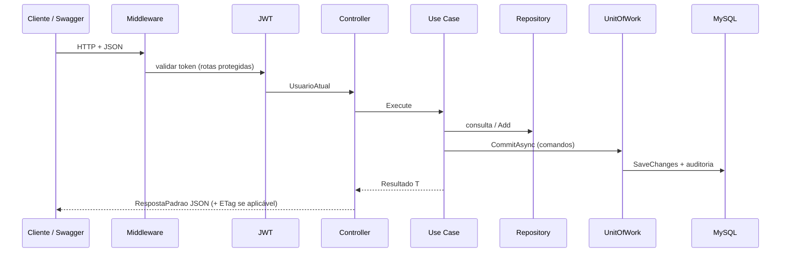
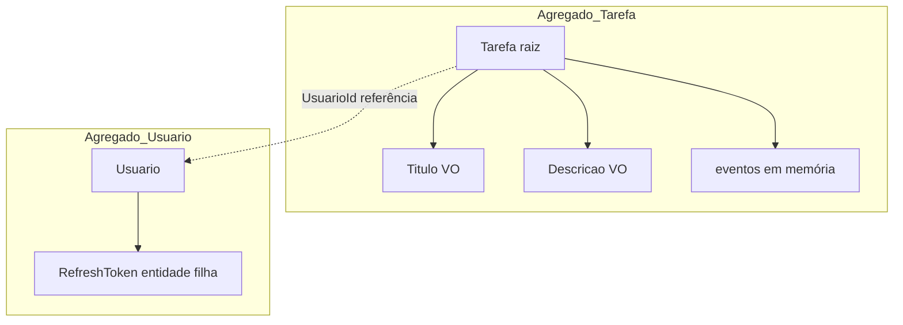
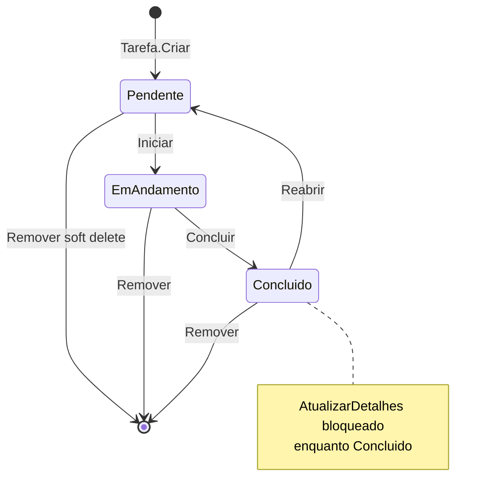
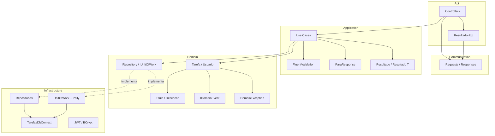
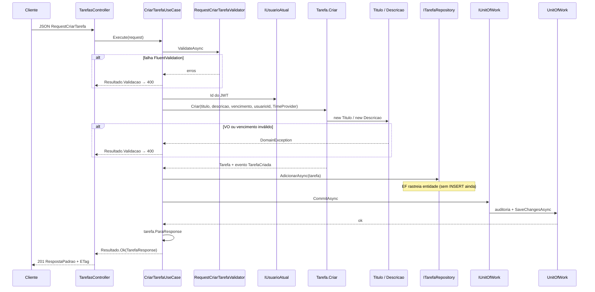
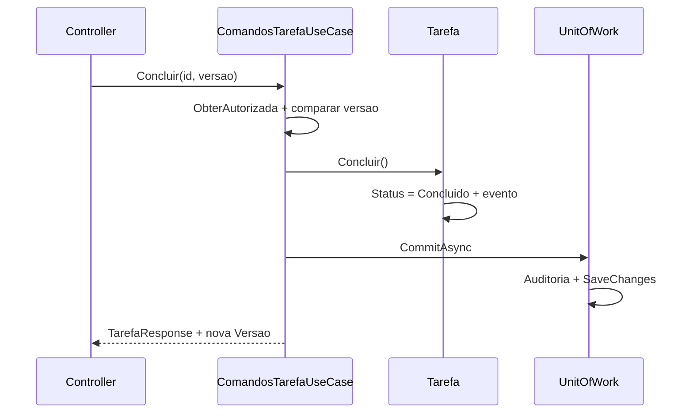
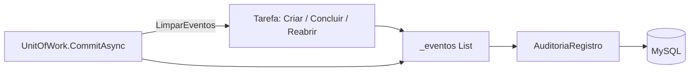

# 📋 Sistema de Gestão de Tarefas (ToDo)

API RESTful para gerenciamento de tarefas, desenvolvida para o desafio técnico .NET — Docker MySQL, execução com F5 no Visual Studio, Swagger na raiz com login e **Authorize**.

[](https://dotnet.microsoft.com/)
[](https://www.mysql.com/)
[](https://www.docker.com/)

---

## 📋 Índice

- [Sobre o Projeto](#-sobre-o-projeto)
- [Funcionalidades](#-funcionalidades)
- [Tecnologias Utilizadas](#-tecnologias-utilizadas)
- [Arquitetura](#️-arquitetura)
- [Fluxos do Projeto](#-fluxos-do-projeto)
  - [Docker (API e banco)](#1-fluxo-docker-api--banco)
  - [TDD do domínio](#2-fluxo-tdd-do-domínio-fase-1)
  - [Polly (resiliência)](#3-fluxo-de-resiliência-polly)
  - [HTTP (Swagger)](#4-fluxo-http-swagger--banco--resposta)
  - [DDD — dependências entre camadas](#5-fluxo-ddd-dependências-entre-camadas)
- [Pré-requisitos](#-pré-requisitos)
- [Instalação e Configuração](#-instalação-e-configuração)
- [Testes Automatizados](#-testes-automatizados)
- [Endpoints da API](#-endpoints-da-api)
- [Testes Manuais via Swagger ou Postman](#-testes-manuais-via-swagger-ou-postman)
- [Estrutura do Projeto](#-estrutura-do-projeto)
- [Solução de Problemas](#-solução-de-problemas)
- [Demo hospedada](#-demo-hospedada)

---

## 📖 Sobre o Projeto

Sistema para **criar, listar, atualizar e concluir tarefas** (ToDo), com status (Pendente, Em andamento, Concluído), filtros por vencimento e status, autenticação JWT e respostas padronizadas (`RespostaPadrao`).

### 🎯 Destaques

✨ **Domínio rico (DDD)**: agregado `Tarefa`, value objects, eventos de domínio e auditoria

🏗️ **Clean Architecture**: Api, Application, Domain, Infrastructure e Communication — Domain sem dependências externas

🔒 **Segurança**: JWT + BCrypt + refresh token rotacionado

⚡ **Concorrência otimista**: `ETag` no GET + header `If-Match` em PUT e comandos de status

✅ **TDD no Domain**: regras nascem dos testes em `SistemaTarefas.Domain.Tests`

🔄 **Polly**: retry e circuit breaker apenas no `UnitOfWork.CommitAsync`

📚 **Swagger na raiz**: login → copiar token → **Authorize** → testar rotas protegidas

---

## 🚀 Funcionalidades

- ✅ **CRUD de Tarefas**: criar, listar (filtros + paginação), obter por ID, atualizar e excluir (soft delete)
- ✅ **Autenticação JWT**: registrar, login, refresh e logout
- ✅ **Fluxo de status**: iniciar, concluir e reabrir tarefa
- ✅ **Filtros do enunciado**: status, vencimento, atrasadas, busca textual
- ✅ **Validações**: FluentValidation na Application + regras no Domain
- ✅ **Respostas padronizadas**: envelope `RespostaPadrao` em todos os endpoints
- ✅ **Documentação interativa**: Swagger/OpenAPI com descrições por endpoint, códigos HTTP e JWT (**Authorize**)
- ✅ **Histórico**: trilha em `AuditoriaRegistros` a partir de eventos de domínio
- ✅ **Seed**: usuário admin criado no primeiro startup (Development)
- ✅ **Docker Compose**: MySQL com healthcheck; API opcional em container

---

## 🛠️ Tecnologias Utilizadas

### Backend
- **.NET 8** — ASP.NET Core Web API
- **Entity Framework Core 8** — ORM
- **MySQL 8.0** — banco relacional
- **Pomelo.EntityFrameworkCore.MySql 8** — provider MySQL

### Segurança
- **JWT Bearer** — access token
- **BCrypt.Net-Next** — hash de senhas

### Qualidade e testes
- **xUnit**, **Moq**, **FluentAssertions**
- **NetArchTest** — regras de dependência entre camadas
- **Testcontainers** — testes de integração com MySQL

### Ferramentas
- **FluentValidation** — validação de requests
- **Polly** — resiliência no commit
- **Serilog**, **OpenTelemetry** (console)
- **Swashbuckle** — Swagger/OpenAPI
- **Docker Compose** — MySQL e stack completa

---

## 🏗️ Arquitetura

O projeto segue **Clean Architecture** com **DDD** na camada de domínio:

```
┌─────────────────────────────────────────┐
│           API (Apresentação)            │  ← Controllers, Middlewares, JWT
├─────────────────────────────────────────┤
│         Application (Casos de Uso)      │  ← Use Cases, Validators, Resultado
├─────────────────────────────────────────┤
│       Domain (Entidades e Contratos)    │  ← Tarefa, VO, Eventos, IRepository
├─────────────────────────────────────────┤
│   Infrastructure (Implementações)       │  ← EF Core, Repositories, Polly, JWT
├─────────────────────────────────────────┤
│    Communication (Contratos de API)     │  ← Requests, Responses, RespostaPadrao
└─────────────────────────────────────────┘
```

### Princípios e Padrões Aplicados

- ✅ **SOLID** — responsabilidades separadas por camada
- ✅ **DRY** — mapeamentos e validadores reutilizáveis
- ✅ **Dependency Injection** — `AddJwtAuthentication`, `AddMySqlConfiguration`, `AddApplication`
- ✅ **Repository Pattern** — abstração de persistência
- ✅ **Unit of Work** — commit único; repositórios não chamam `SaveChanges`
- ✅ **Use Case Pattern** — uma operação por interface/classe
- ✅ **Result Pattern** — `Resultado<T>` na Application; HTTP via `ResultadoHttp`
- ✅ **Domain Events** — auditoria derivada no commit

---

## 🔀 Fluxos do Projeto

Visão de como o sistema **sobe**, como o **domínio foi construído**, como o **banco se protege** e como uma **requisição HTTP** percorre as camadas.

### 1. Fluxo Docker (API ↔ banco)

**Stack completa** (`docker compose up --build`): a API só inicia depois do MySQL **healthy**; connection string por variável de ambiente; migrations no startup.



| Modo | Comando | API | Banco |
|------|---------|-----|-------|
| **Desenvolvimento local (F5)** | `docker compose up -d mysql` + **F5** | `localhost:5000` | `localhost:3307` |
| **Tudo em container** | `docker compose up --build` | `:5000` | serviço `mysql` na rede Docker |

No **F5**, o `InicializadorBanco` (`Program.cs`) executa `MigrateAsync` e cria o usuário **admin** (até 10 tentativas se o MySQL ainda estiver subindo).

```text
[F5]  Visual Studio → SistemaTarefas.Api → http://localhost:5000
      Docker         → tarefas-mysql:3307
      Startup        → migrations + seed
```

---

### 2. Fluxo TDD do domínio (Fase 1)

Ordem de construção: **teste falha → agregado / VO / eventos → teste passa**. Application, Infrastructure e HTTP **não entram** neste ciclo.



| Ordem | Exemplo de teste (`SistemaTarefas.Domain.Tests`) |
|-------|--------------------------------------------------|
| 1 | Título curto / vazio |
| 2 | Vencimento no passado |
| 3 | Transição ilegal (iniciar duas vezes, concluir sem iniciar) |
| 4 | Reabrir após concluir |
| 5 | Fluxo feliz pendente → em andamento → concluído |

---

### 3. Fluxo de resiliência (Polly)

Polly fica **somente** em `UnitOfWork.CommitAsync`, envolvendo `SaveChangesAsync`. Domain e use cases **não** conhecem Polly.



| Peça | Comportamento |
|------|----------------|
| **Retry** | Até 3 tentativas em falhas transientes de EF (não inclui concorrência) |
| **Circuit breaker** | Após muitas falhas, commit falha rápido |
| **Concorrência** | `DbUpdateConcurrencyException` → middleware **412** (If-Match / versão) |

O Pomelo também tem retry na **conexão** (`MySqlConfig`) — isso é separado do Polly do commit.

---

### 4. Fluxo HTTP (Swagger → banco → resposta)



**Login e Authorize:**

1. `POST /api/v1/auth/login` → copiar `dados.token`
2. Swagger **Authorize** → `Bearer {token}`
3. Chamar rotas de tarefas com cadeado fechado

**Comandos com versão:** `GET /api/v1/tarefas/{id}` devolve header **ETag**; `PUT`, `DELETE` e `POST .../iniciar|concluir|reabrir` exigem **If-Match** com essa versão.

---

### 5. Fluxo DDD (dependências entre camadas)

**DDD tático** aqui significa: regras de negócio **dentro** do Domain (agregado + value objects); Application **coordena** sem substituir o domínio; Infrastructure **implementa** persistência e JWT. A API só traduz HTTP ↔ use cases.

#### Linguagem ubíqua (termos do código)

| Termo | Significado no sistema |
|-------|-------------------------|
| **Tarefa** | Agregado raiz do ToDo; dono = `UsuarioId` |
| **Status** | `Pendente` → `EmAndamento` → `Concluido` (reabrir volta a `Pendente`) |
| **Versão** | Controle de concorrência otimista (`Versao` + ETag / If-Match) |
| **Usuário** | Agregado de identidade; login emite JWT (fora do agregado Tarefa) |
| **Auditoria** | Registro derivado de **eventos de domínio**, não é agregado exposto na API |

#### Agregados e limites



| Agregado | Raiz | O que **não** fazer |
|----------|------|---------------------|
| **Tarefa** | `Tarefa` | Alterar título/status por setter público; sempre via `Criar`, `Iniciar`, `Concluir`, etc. |
| **Usuario** | `Usuario` | Criar usuário no controller; use `RegistrarUsuarioUseCase` + `Usuario.Criar` |

`RefreshToken` pertence ao contexto de **auth**, não à Tarefa. Repositórios expõem **portas** no Domain (`ITarefaRepository`), implementação na Infrastructure.

#### Máquina de estados da Tarefa (regras no Domain)



Cada transição válida pode **incrementar `Versao`** e, em alguns casos, **registrar evento** (`TarefaConcluida`, `TarefaReaberta`, `TarefaCriada`).

#### Mapa de referências (dependências entre camadas)



| Camada | Pode | Não pode |
|--------|------|----------|
| **Domain** | Regras, VO, eventos, interfaces de repositório | Referenciar EF, HTTP, JWT, DTOs |
| **Application** | Orquestrar, validar entrada, `Resultado<T>` | `SaveChanges`, DbContext, detalhes SQL |
| **Infrastructure** | EF, repositórios, UoW, Polly, token | Regra de negócio de tarefa |
| **Api** | Auth HTTP, headers ETag/If-Match, status code | `if (status == Concluido)` de negócio |

Testes **`DependenciasTests`** (Architecture) garantem que essas fronteiras não sejam quebradas no código.

#### Comando × consulta (CQRS leve)

| Tipo | Exemplos | Domínio | Commit |
|------|----------|---------|--------|
| **Comando** | Criar, PUT, iniciar/concluir/reabrir, excluir | Métodos no agregado | `IUnitOfWork.CommitAsync` |
| **Consulta** | Listar, obter por id, histórico | Só leitura; `ParaResponse` | Geralmente **sem** UoW (histórico usa `IAuditoriaConsulta`) |

Listar aplica filtros no **repositório** (Infrastructure), mas **não muda** o agregado — é projeção para `TarefaResponse`.

---

#### Fluxo DDD detalhado: **criar tarefa** (`POST /api/v1/tarefas`)



**Passo a passo (arquivos):**

1. `TarefasController.Criar` — recebe `RequestCriarTarefa` (Communication).
2. `CriarTarefaUseCase` — validação **de entrada** (FluentValidation).
3. `Tarefa.Criar` — validação **de negócio** (vencimento futuro, VO de título).
4. `TarefaRepository.AdicionarAsync` — adiciona ao `DbContext` (memória).
5. `UnitOfWork.CommitAsync` — lê eventos do agregado → `AuditoriaRegistros` → `SaveChanges` (Polly).
6. `TarefaMappings.ParaResponse` — monta DTO **sem** expor entidade EF na API.
7. `ResultadoHttp.ParaHttp` — envelope `RespostaPadrao`.

---

#### Fluxo DDD detalhado: **concluir tarefa** (comando + versão)

1. **Api:** `If-Match` lido no controller → `uint versao`.
2. **Application:** `ComandosTarefaUseCase.Concluir` → carrega tarefa → **autorização** (dono ou admin).
3. **Application:** se `versao != tarefa.Versao` → `Resultado.Conflito` (409) **antes** de chamar o domínio.
4. **Domain:** `tarefa.Concluir(relogio)` — se não estiver `EmAndamento`, `DomainException` → vira `Resultado.Validacao`.
5. **Domain:** adiciona `TarefaConcluida` à lista interna de eventos.
6. **Infrastructure:** `CommitAsync` persiste mudanças + linhas de auditoria; `Versao` sobe (token de concorrência EF).



---

#### Fluxo DDD detalhado: **listar tarefas** (consulta)

1. `ListarTarefasUseCase` — normaliza paginação (Application).
2. `IUsuarioAtual` — restringe query ao `UsuarioId` (ou admin vê todas).
3. `TarefaRepository.ListarAsync` — IQueryable + filtros (status, vencimento, atrasadas, busca).
4. **Sem** `CommitAsync` — nenhum evento de domínio disparado.
5. Projeção: `Select` implícito via `ParaResponse` em memória após materializar página.

---

#### Value Objects e persistência (anti-corruption na Infrastructure)

- `Titulo` e `Descricao` validam no **construtor** (Domain).
- `TarefasDbContext` converte VO ↔ coluna string (`HasConversion`) — EF é detalhe de Infrastructure; Domain não sabe que existe MySQL.

---

#### Três caminhos de “erro” (onde cada um nasce)

| Origem | Mecanismo | HTTP típico |
|--------|-----------|-------------|
| JSON inválido / campo vazio | FluentValidation → `Resultado.Validacao` | 400 |
| Regra de negócio (VO, transição) | `DomainException` capturada no use case **ou** middleware | 400 / 422 |
| Recurso / versão / auth | `Resultado` (`NaoEncontrado`, `Conflito`, `NaoAutorizado`) | 404 / 409 / 401 |
| Concorrência EF | `DbUpdateConcurrencyException` | 412 |
| Falha infra (Polly circuito) | Exception não tratada | 500 |

Os use cases devolvem **`Resultado<T>`**; o controller só traduz para HTTP — regra de negócio não fica na Api.

---

#### Eventos de domínio → auditoria (mesma transação)



| Evento | Quando | Uso |
|--------|--------|-----|
| `TarefaCriada` | `Tarefa.Criar` | Histórico + rastreio |
| `TarefaConcluida` | `Concluir` | Histórico |
| `TarefaReaberta` | `Reabrir` | Histórico |

`GET .../historico` lê **AuditoriaRegistros** via `IAuditoriaConsulta` — não reexecuta regras do agregado.

---

#### Auth no DDD (login — fluxo resumido)

Auth é **caso de uso de aplicação** + **infra de token**, não passa pelo agregado `Tarefa`:

1. `LoginUseCase` → `IUsuarioRepository.ObterPorNomeAsync`
2. `IPasswordHasher.Verificar` (Infrastructure / BCrypt)
3. `ITokenService.GerarAccessToken` (Infrastructure / JWT)
4. `AdicionarRefreshTokenAsync` + `CommitAsync` — persiste refresh **sem** alterar campos desnecessários do usuário

---

## 📦 Pré-requisitos

| Software | Versão mínima |
|----------|----------------|
| **.NET SDK** | 8.0 |
| **Docker Desktop** | recente |
| **Git** | recente (opcional) |

**Opcional:** Visual Studio 2022, Postman, MySQL Workbench.

---

## 💻 Instalação e Configuração

### 📥 Passo 1: Clonar o repositório

```bash
git clone https://github.com/eutiagoportela/SistemaTarefas.git
cd SistemaTarefas
```

### 🐳 Passo 2: Iniciar o MySQL com Docker

Na pasta raiz (onde está o `docker-compose.yml`):

```bash
docker compose up -d mysql
```

**Verificar:**

```bash
docker ps
```

Container esperado: **`tarefas-mysql`**, porta **3307 → 3306**.

⏳ Aguarde o healthcheck ficar **healthy** (cerca de 20–40 s).

### 📦 Passo 3: Restaurar pacotes

```bash
dotnet restore
```

### 🗄️ Passo 4: Banco de dados (migrations)

**Não é obrigatório rodar CLI manualmente** — na subida da API, o `InicializadorBanco` executa `MigrateAsync` e cria o usuário admin.

Opcional (CLI):

```bash
dotnet ef database update --project src/SistemaTarefas.Infrastructure --startup-project src/SistemaTarefas.Api
```

**Seed (Development):**

| Usuário | Senha |
|---------|--------|
| `admin` | `Admin123` |

### ▶️ Passo 5: Executar a API

**Opção A — Visual Studio (recomendado)**

1. Abrir `SistemaTarefas.sln`
2. Startup project: **SistemaTarefas.Api**
3. **F5**

**Opção B — CLI**

```bash
dotnet run --project src/SistemaTarefas.Api
```

**Opção C — Docker (API + MySQL)**

```bash
docker compose up --build
```

**URLs:**

```
🌐 Swagger UI:     http://localhost:5000
🏥 Health Check:   http://localhost:5000/health
📡 API Base:       http://localhost:5000/api/v1
```

**Console esperado (Development):**

```
API SistemaTarefas em http://localhost:5000
Swagger na raiz. Login: POST /api/v1/auth/login
```

### 🧪 Passo 6: Executar os testes automatizados

**Via .NET CLI (rápido — sem integração):**

```bash
dotnet test --filter "Category!=Integration"
```

**Suite completa (inclui integração — Docker Desktop ligado):**

```bash
dotnet test
```

**Via Visual Studio:**

1. Menu **Teste** → **Gerenciador de Testes** (ou `Ctrl+E, T`)
2. **Executar** todos (`Ctrl+R, A`)

**Resultado esperado:** 13 testes aprovados, 0 falhas (12 unitários/arquitetura + 1 integração).

---

## 🧪 Testes Automatizados

A solution possui **4 projetos de teste** (visíveis no **Gerenciador de Testes** do Visual Studio). Eles validam camadas diferentes — não substituem o roteiro manual no Swagger (Fases 1–4 abaixo), mas provam regras de negócio, arquitetura e um fluxo ponta a ponta.

### Visão geral

| Projeto | Qtd. | O que garante |
|---------|------|----------------|
| `SistemaTarefas.Domain.Tests` | 8 | **TDD do domínio** — agregado `Tarefa`, título/descrição, vencimento futuro, transições (iniciar, concluir, reabrir). Sem HTTP e sem banco. |
| `SistemaTarefas.Application.Tests` | 2 | **Use case** `CriarTarefaUseCase` — validação de entrada e chamada ao `CommitAsync` (Moq). |
| `SistemaTarefas.Architecture.Tests` | 2 | **NetArchTest** — Domain não referencia Application/Infrastructure/Api; Application não referencia Infrastructure/Api. |
| `SistemaTarefas.Api.IntegrationTests` | 1 | **Integração** — sobe MySQL em container (Testcontainers), faz login e cria tarefa via HTTP real. |

### Exemplos de testes (Domain)

- `Criar_DeveFalhar_QuandoTituloForCurto`
- `Criar_DeveFalhar_QuandoVencimentoNaoForFuturo`
- `FluxoFeliz_IniciarConcluirReabrir`
- `Iniciar_DeveFalhar_QuandoNaoEstiverPendente`

### Exemplos (Application e Architecture)

- `Execute_DevePersistir_QuandoDadosValidos` / `Execute_DeveRetornarValidacao_QuandoTituloVazio`
- `Domain_NaoDeveDependerDeOutrasCamadas`
- `Application_NaoDeveDependerDeInfrastructureNemApi`

### Exemplo (Integração)

- `Login_E_CriarTarefa_DeveFuncionar` — exige **Docker** em execução (container MySQL efêmero).

### Quando usar cada comando

| Comando | Quando |
|---------|--------|
| `dotnet test --filter "Category!=Integration"` | CI rápido, desenvolvimento do dia a dia (~100 ms) |
| `dotnet test` | Antes de entregar; valida também API + banco |
| Gerenciador de Testes (VS) | Mesmo que CLI; útil para debugar um teste isolado |

Ferramentas: **xUnit**, **Moq**, **FluentAssertions**, **NetArchTest.Rules**, **Testcontainers.MySql**.

---

## 📡 Endpoints da API

| Método | Rota | Auth |
|--------|------|------|
| POST | `/api/v1/auth/registrar` | Não |
| POST | `/api/v1/auth/login` | Não |
| POST | `/api/v1/auth/refresh` | Não |
| POST | `/api/v1/auth/logout` | Sim |
| GET / POST | `/api/v1/tarefas` | Sim |
| GET / PUT / DELETE | `/api/v1/tarefas/{id}` | Sim |
| POST | `/api/v1/tarefas/{id}/iniciar`, `/concluir`, `/reabrir` | Sim + **If-Match** |
| GET | `/api/v1/tarefas/{id}/historico` | Sim |
| GET | `/health`, `/health/ready` | Não |

---

## 🧪 Testes Manuais via Swagger ou Postman

Roteiro completo para validar a API em **fases**: autenticação → CRUD → regras de negócio → autorização.

**Configuração global:**

- **Base URL:** `http://localhost:5000`
- **Content-Type:** `application/json`
- **Authorization (fases 2+):** `Bearer {{token}}`

---

## 🔐 FASE 1: Autenticação

### ✅ Teste 1.1: Login com sucesso

```http
POST http://localhost:5000/api/v1/auth/login
Content-Type: application/json

{
  "nomeUsuario": "admin",
  "senha": "Admin123"
}
```

**Resposta esperada:** `200 OK`

```json
{
  "sucesso": true,
  "mensagem": "Login realizado com sucesso",
  "dados": {
    "token": "eyJhbGciOiJIUzI1NiIsInR5cCI6IkpXVCJ9...",
    "refreshToken": "...",
    "expiraEm": "2026-10-24T23:00:00Z"
  },
  "erros": null,
  "traceId": "..."
}
```

**Validações:**

- Status 200, `sucesso: true`, `dados.token` preenchido
- **Swagger:** botão **Authorize** → informar `Bearer {token}` (com a palavra Bearer)

**Ação:** salvar `dados.token` como `{{token}}` no Postman ou usar no Authorize do Swagger.

---

### ❌ Teste 1.2: Login com usuário inexistente

```http
POST http://localhost:5000/api/v1/auth/login
Content-Type: application/json

{
  "nomeUsuario": "nao_existe",
  "senha": "Admin123"
}
```

**Resposta esperada:** `401 Unauthorized` — `sucesso: false`, mensagem de credenciais inválidas.

---

### ❌ Teste 1.3: Login com senha incorreta

```http
POST http://localhost:5000/api/v1/auth/login
Content-Type: application/json

{
  "nomeUsuario": "admin",
  "senha": "senha_errada"
}
```

**Resposta esperada:** `401 Unauthorized`

---

### ❌ Teste 1.4: Login com campos vazios

```http
POST http://localhost:5000/api/v1/auth/login
Content-Type: application/json

{
  "nomeUsuario": "",
  "senha": ""
}
```

**Resposta esperada:** `400 Bad Request` — erros de validação FluentValidation.

---

### ✅ Teste 1.5: Registrar novo usuário

```http
POST http://localhost:5000/api/v1/auth/registrar
Content-Type: application/json

{
  "nomeUsuario": "usuario_teste",
  "senha": "Senha1234"
}
```

**Resposta esperada:** `200 OK` — `mensagem`: usuário registrado.

> Senha: mínimo 8 caracteres, ao menos uma letra e um número.

---

### ❌ Teste 1.6: Registrar usuário duplicado

```http
POST http://localhost:5000/api/v1/auth/registrar
Content-Type: application/json

{
  "nomeUsuario": "admin",
  "senha": "Senha1234"
}
```

**Resposta esperada:** `409 Conflict` — admin já existe.

---

## 📝 FASE 2: CRUD de Tarefas

> **IMPORTANTE:** Em todos os testes desta fase, use:
>
> ```
> Authorization: Bearer {{token}}
> ```

---

### ✅ Teste 2.1: Criar tarefa

```http
POST http://localhost:5000/api/v1/tarefas
Authorization: Bearer {{token}}
Content-Type: application/json

{
  "titulo": "Enviar documentação",
  "descricao": "README e fluxos",
  "dataVencimento": "2026-12-15T18:00:00Z"
}
```

**Resposta esperada:** `201 Created`

- `dados.status` = `Pendente`
- Header **ETag** com a versão (ex.: `"1"`)

**Ação:** guardar `dados.id` como `{{tarefaId}}` e o **ETag** como `{{versao}}`.

---

### ✅ Teste 2.2: Listar tarefas (filtro status)

```http
GET http://localhost:5000/api/v1/tarefas?status=Pendente&pagina=1&tamanho=20
Authorization: Bearer {{token}}
```

**Resposta esperada:** `200 OK` — `dados.itens` com paginação (`total`, `pagina`, `tamanho`).

---

### ✅ Teste 2.3: Buscar tarefa por ID

```http
GET http://localhost:5000/api/v1/tarefas/{{tarefaId}}
Authorization: Bearer {{token}}
```

**Resposta esperada:** `200 OK` + header **ETag**.

---

### ❌ Teste 2.4: Buscar tarefa inexistente

```http
GET http://localhost:5000/api/v1/tarefas/00000000-0000-0000-0000-000000000000
Authorization: Bearer {{token}}
```

**Resposta esperada:** `404 Not Found`

---

### ✅ Teste 2.5: Atualizar tarefa (com If-Match)

```http
PUT http://localhost:5000/api/v1/tarefas/{{tarefaId}}
Authorization: Bearer {{token}}
If-Match: {{versao}}
Content-Type: application/json

{
  "titulo": "Enviar documentação (revisada)",
  "descricao": "README completo",
  "dataVencimento": "2026-12-20T18:00:00Z"
}
```

**Resposta esperada:** `200 OK` — nova versão no corpo; atualizar `{{versao}}` pelo novo ETag.

---

### ❌ Teste 2.6: Atualizar sem If-Match

```http
PUT http://localhost:5000/api/v1/tarefas/{{tarefaId}}
Authorization: Bearer {{token}}
Content-Type: application/json

{
  "titulo": "Sem versao",
  "descricao": "Teste",
  "dataVencimento": "2026-12-20T18:00:00Z"
}
```

**Resposta esperada:** `428 Precondition Required`

---

### ❌ Teste 2.7: Criar tarefa com título inválido (curto)

```http
POST http://localhost:5000/api/v1/tarefas
Authorization: Bearer {{token}}
Content-Type: application/json

{
  "titulo": "ab",
  "descricao": "Teste",
  "dataVencimento": "2026-12-15T18:00:00Z"
}
```

**Resposta esperada:** `400` ou `422` — regra de domínio/validação.

---

## 🔄 FASE 3: Status e histórico

### ✅ Teste 3.1: Iniciar tarefa

```http
POST http://localhost:5000/api/v1/tarefas/{{tarefaId}}/iniciar
Authorization: Bearer {{token}}
If-Match: {{versao}}
```

**Resposta esperada:** `200 OK` — `dados.status` = `EmAndamento`.

---

### ✅ Teste 3.2: Concluir tarefa

```http
POST http://localhost:5000/api/v1/tarefas/{{tarefaId}}/concluir
Authorization: Bearer {{token}}
If-Match: {{versao}}
```

**Resposta esperada:** `200 OK` — `dados.status` = `Concluido`, `dataConclusao` preenchida.

---

### ✅ Teste 3.3: Reabrir tarefa

```http
POST http://localhost:5000/api/v1/tarefas/{{tarefaId}}/reabrir
Authorization: Bearer {{token}}
If-Match: {{versao}}
```

**Resposta esperada:** `200 OK` — status volta para `Pendente`.

---

### ❌ Teste 3.4: Concluir tarefa ainda pendente (sem iniciar)

Crie outra tarefa e tente `POST .../concluir` direto — **400/422** (só conclui em andamento).

---

### ✅ Teste 3.5: Histórico da tarefa

```http
GET http://localhost:5000/api/v1/tarefas/{{tarefaId}}/historico
Authorization: Bearer {{token}}
```

**Resposta esperada:** `200 OK` — lista de eventos/auditoria.

---

### ✅ Teste 3.6: Excluir tarefa (soft delete)

```http
DELETE http://localhost:5000/api/v1/tarefas/{{tarefaId}}
Authorization: Bearer {{token}}
If-Match: {{versao}}
```

**Resposta esperada:** `200 OK` — tarefa removida logicamente.

---

## 🔒 FASE 4: Autorização

### ❌ Teste 4.1: Listar tarefas sem token

```http
GET http://localhost:5000/api/v1/tarefas
```

**Resposta esperada:** `401 Unauthorized`

---

### ❌ Teste 4.2: Token inválido

```http
GET http://localhost:5000/api/v1/tarefas
Authorization: Bearer token_invalido
```

**Resposta esperada:** `401 Unauthorized`

---

## 📁 Estrutura do Projeto

```plaintext
📦 Solution 'SistemaTarefas'
├── 📁 src/
│   ├── 📁 SistemaTarefas.Api/                         # 🎯 Apresentação
│   │   ├── 📁 Controllers/
│   │   │   ├── 📄 AuthController.cs                 # /api/v1/auth/*
│   │   │   └── 📄 TarefasController.cs                # CRUD + status + histórico
│   │   ├── 📁 Middlewares/
│   │   │   └── 📄 ExceptionHandlingMiddleware.cs
│   │   ├── 📁 Extensoes/
│   │   │   └── 📄 ResultadoHttp.cs
│   │   ├── 📄 Program.cs
│   │   └── 📄 appsettings.Development.json
│   │
│   ├── 📁 SistemaTarefas.Application/               # ⚙️ Casos de uso
│   │   ├── 📁 UseCases/
│   │   │   ├── 📁 Auth/
│   │   │   │   ├── 📄 LoginUseCase.cs
│   │   │   │   ├── 📄 RegistrarUsuarioUseCase.cs
│   │   │   │   └── 📄 RefreshTokenUseCase.cs
│   │   │   └── 📁 Tarefas/
│   │   │       ├── 📄 CriarTarefaUseCase.cs
│   │   │       ├── 📄 ListarTarefasUseCase.cs
│   │   │       ├── 📄 ObterTarefaUseCase.cs
│   │   │       └── 📄 ComandosTarefaUseCase.cs        # PUT, status, delete, histórico
│   │   ├── 📁 Validadores/
│   │   ├── 📁 Extensions/
│   │   │   └── 📄 DependencyInjectionExtension.cs
│   │   └── 📁 Abstracoes/                             # IUnitOfWork, IUsuarioAtual, ...
│   │
│   ├── 📁 SistemaTarefas.Communication/               # 📨 Contratos HTTP
│   │   ├── 📁 Requests/
│   │   └── 📁 Responses/
│   │       └── 📄 RespostaPadrao.cs
│   │
│   ├── 📁 SistemaTarefas.Domain/                      # 🧠 Domínio
│   │   ├── 📁 Entidades/
│   │   │   ├── 📄 Tarefa.cs                           # Agregado
│   │   │   └── 📄 Usuario.cs
│   │   ├── 📁 ValueObjects/
│   │   ├── 📁 Eventos/
│   │   ├── 📁 Repositorios/                           # Interfaces
│   │   └── 📁 Resultados/                             # Resultado<T>
│   │
│   └── 📁 SistemaTarefas.Infrastructure/              # 🔧 Infra
│       ├── 📁 Persistencia/
│       │   ├── 📄 TarefasDbContext.cs
│       │   ├── 📄 MySqlConfig.cs
│       │   └── 📄 InicializadorBanco.cs                 # MigrateAsync + seed
│       ├── 📁 Repositories/
│       │   ├── 📄 TarefaRepository.cs
│       │   ├── 📄 UsuarioRepository.cs
│       │   └── 📄 UnitOfWork.cs                         # Polly + auditoria
│       ├── 📁 Seguranca/
│       │   ├── 📄 Authentication.cs                     # JWT Bearer + DI
│       │   ├── 📄 TokenService.cs
│       │   └── 📄 PasswordHasher.cs
│       └── 📁 Migrations/
│
├── 📁 tests/
│   ├── 📁 SistemaTarefas.Domain.Tests/                # TDD
│   ├── 📁 SistemaTarefas.Application.Tests/
│   ├── 📁 SistemaTarefas.Architecture.Tests/
│   └── 📁 SistemaTarefas.Api.IntegrationTests/
│
├── 📄 Directory.Build.props                             # Propriedades comuns de todos os .csproj
├── 📄 Directory.Packages.props                        # Versões centralizadas de NuGet
├── 📄 global.json                                     # SDK .NET 8 fixo na solution
├── 📄 docker-compose.yml
├── 📄 Dockerfile
├── 📄 SistemaTarefas.sln
└── 📄 README.md
```

### Arquivos na raiz (gestão centralizada da solution)

| Arquivo | Função |
|---------|--------|
| **Directory.Build.props** | Aplica a **mesma configuração** em todos os projetos da pasta (`net8.0`, nullable, implicit usings, lang version). Evita repetir `<PropertyGroup>` em cada `.csproj`. |
| **Directory.Packages.props** | **Central Package Management (CPM)**: versões dos pacotes NuGet ficam **só aqui**; nos `.csproj` entra `<PackageReference Include="..." />` **sem** `Version=`. Facilita atualizar EF, Pomelo, xUnit etc. em um lugar. |
| **global.json** | Fixa qual SDK .NET a solution usa (8.0.426), para build igual em máquina do avaliador e CI. |

---

## 🔧 Solução de Problemas

| Problema | Solução |
|----------|---------|
| Swagger não abre (JSON 401 na raiz) | Stop + F5; Swagger configurado **antes** de auth; acesse `http://localhost:5000` |
| MySQL connection refused | `docker compose up -d mysql` e aguarde healthy |
| Login 412 / concorrência | Rebuild com API parada (versão antiga em memória) |
| Authorize não funciona | Use `Bearer {token}` no Swagger |
| PUT/iniciar retorna 428 | Envie header `If-Match` com versão do ETag do GET |
| Build falha (DLL locked) | Pare o debug no Visual Studio antes de compilar |

---

## 🌐 Demo hospedada

A API está publicada no **Render** (Docker) com banco MySQL gerenciado na nuvem.

| Item | Valor |
|------|--------|
| **Swagger UI** | https://sistema-tarefas-api-1rdd.onrender.com |
| **OpenAPI JSON** | https://sistema-tarefas-api-1rdd.onrender.com/swagger/v1/swagger.json |
| **Health** | https://sistema-tarefas-api-1rdd.onrender.com/health |
| **Login (demo online)** | usuário `demo` / senha `DemoSegura2026!` |

### Como testar (Swagger)

1. Abra a **Swagger UI** (link acima). No plano free, a primeira requisição após idle pode levar ~1 min.
2. **GET /health** → Execute → resposta **Healthy**.
3. **POST /api/v1/auth/login** com o JSON:

```json
{
  "nomeUsuario": "demo",
  "senha": "DemoSegura2026!"
}
```

4. Copie `dados.token` → botão **Authorize** → `Bearer {token}`.
5. **POST /api/v1/tarefas** (criar) ou **GET /api/v1/tarefas** (listar) — anote o **`id`** e o número **`versao`** da tarefa (tarefa nova costuma ter `versao: 1`).
6. Em **PUT**, **DELETE** ou **POST …/iniciar|concluir|reabrir**, preencha o header **`If-Match`** no Swagger com esse número (ex.: `1`). Também vale o valor do header **ETag** do **GET /api/v1/tarefas/{id}** (com ou sem aspas).
7. Sem `If-Match` a API responde **428** — isso é esperado (concorrência otimista). Mais detalhes nas **Fases 2–3** deste README.

Execução **local** (Docker + F5): seção [Instalação e Configuração](#-instalação-e-configuração) — usuário `admin` / `Admin123`.
